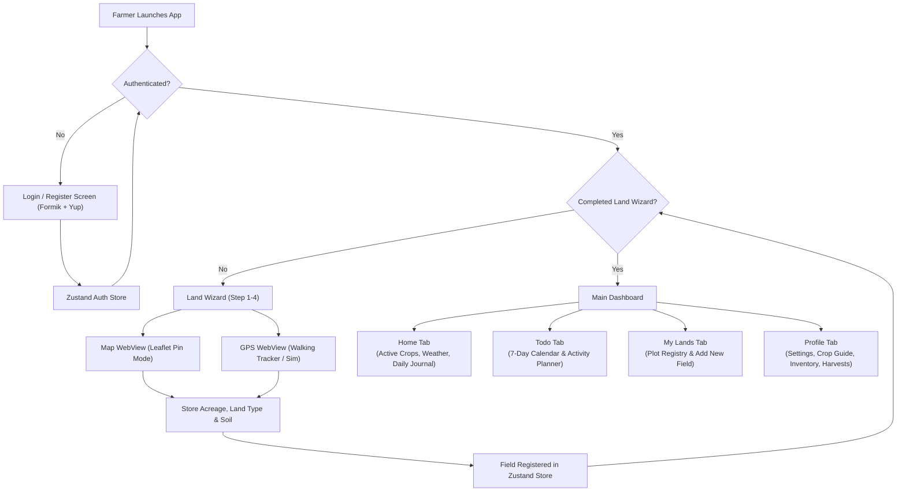

# 🌱 Sprout — Smart Agriculture Mobile App

[](https://docs.expo.dev/versions/v54.0.0/)
[](https://reactnative.dev/)
[](https://react.dev/)
[](https://github.com/pmndrs/zustand)
[](https://formik.org/)
[]()

**Sprout** is an intuitive, all-in-one smart farming and land management mobile application built with **React Native** and **Expo SDK 54**. Designed specifically for farmers and agriculturalists, Sprout bridges field operations with modern digital agronomy—enabling interactive satellite/map land boundary measurements, GPS perimeter walk tracking, bilingual crop guidance (English & தமிழ் / Tamil), automated growth milestone schedules, farm task checklists, inventory tracking, and past harvest logs.

---

## 📑 Table of Contents

- [About This Project](#-about-this-project)
- [Key Features](#-key-features)
- [System Architecture & Workflow](#-system-architecture--workflow)
- [Tech Stack](#-tech-stack)
- [Folder Structure](#-folder-structure)
- [Installation Guide](#-installation-guide)
- [Start Guide (Getting Started)](#-start-guide-getting-started)
- [User Guide & Application Walkthrough](#-user-guide--application-walkthrough)
- [Theming & Accessibility](#-theming--accessibility)
- [Author Information](#-author-information)
- [License](#-license)

---

## 🌾 About This Project

Modern agriculture requires precise parcel knowledge, tailored soil-crop matchmaking, and consistent operational management. Smallholder and commercial farmers frequently face challenges calculating exact field acreage, choosing suitable crops for regional soil types, and maintaining day-to-day farming logs.

**Sprout** addresses these challenges by delivering:
1. **Accurate Land Acreage Estimation**: Calculate exact acreage by dropping boundary pins on interactive satellite maps or walking the farm perimeter using real-time GPS coordinates.
2. **Soil & Land Profile Compatibility**: Match plots (Wetland / நஞ்சை, Dryland / புஞ்சை, Garden Land / தோட்டம்) with specific soil classifications (Red, Brown/Laterite, Black/Cotton, Grey/Peat, Alluvial) to recommend optimal crops and fertilization routines.
3. **Bilingual Regional Support**: Native bilingual support (English and Tamil) for land categories, soil profiles, and crop libraries (e.g., *Paddy / நெல்*, *Sugarcane / கரும்பு*, *Ragi / கேழ்வரகு*).
4. **Full Lifecycle Crop Management**: Monitor crop growth stages from nursery bed preparation to harvesting, complete with dynamic progress tracking and journal note entries.
5. **Farm Operations & Logistics**: Plan weekly chores, manage seed and fertilizer inventory with auto-deduction upon sowing, and review historical harvest yields.

---

## ✨ Key Features

### 📍 Dual Land Measurement Modes
- **Interactive Map Pinning (Leaflet.js)**: Drop polygon vertices on open-source satellite and terrain maps via a high-performance WebView interface to compute polygon area in acres.
- **GPS Perimeter Walking (Live Geolocation)**: Walk along field boundaries with live GPS path rendering, distance metrics, accuracy indicators, and perimeter-to-acreage conversion. Includes a **Simulation Walk Mode** for desktop and indoor testing.

### 🚜 Onboarding Land Wizard
- A guided 4-step wizard to register farm plots:
  1. Measure land acreage via Map or GPS (or manual input).
  2. Select Land Profile: Wetland (*நஞ்சை நிலம்*), Dryland (*புஞ்சை நிலம்*), or Garden Land (*தோட்டம்*).
  3. Select Soil Profile: Red (*செம்மண்*), Brown (*பழுப்பு மண்*), Black (*கரிசல் மண்*), Grey (*சாம்பல் மண்*), Alluvial (*வண்டல் மண்*), or Other (*இதர மண்*).
  4. Finalize naming and instantly register the parcel.

### 🌱 Crop Advisory & Milestone Engine
- Pre-loaded database of regional crops containing duration, water requirements, seasonal advice, expected yield, input requirements, and day-by-day milestone checklists.
- **Custom Crop Creator**: Define custom crop recipes with custom durations, stages, and inputs.
- Active crop tracker with day increment/decrement tools, progress bars, and day-stamped journal logging.

### 📋 Task & Todo Planner
- Weekly interactive 7-day calendar view.
- Priority levels: `High`, `Medium`, and `Low`.
- Instant task completion toggles and field-associated task cleanup when removing lands.

### 📦 Farm Inventory & Resource Tracking
- Track seeds, fertilizers, and supplies (units in kg, bags, etc.).
- Automated inventory deduction upon crop sowing when requirements match available stock.

### 📜 Harvest History Logs
- Archive completed crop cycles with duration, yield figures, and journal timelines for seasonal comparison and yield optimization.

### 🎨 Custom Theming & Accessibility
- **Theme Modes**: Light, Dark, and System Adaptive.
- **Pure Black Mode**: True OLED black (`#000000`) for high battery savings on AMOLED screens.
- **Accent Palettes**: Forest (`#059669`), Clay (`#78350f`), Wheat (`#d97706`), Ocean (`#0ea5e9`), and Grape (`#9333ea`).
- **Font Scaling**: Small, Medium, Large, and Extra-Large typography scaling.

---

## 🏗 System Architecture & Workflow



---

## 🛠 Tech Stack

| Category | Technology / Library | Version | Description |
| :--- | :--- | :--- | :--- |
| **Framework** | [React Native](https://reactnative.dev/) | `0.81.5` | Cross-platform native mobile framework |
| **Runtime & Tooling** | [Expo SDK](https://docs.expo.dev/versions/v54.0.0/) | `~54.0.34` | Managed Expo workflow with New Architecture enabled |
| **Core UI Library** | [React](https://react.dev/) | `19.1.0` | Declarative UI component architecture |
| **State Management** | [Zustand](https://github.com/pmndrs/zustand) | `^5.0.14` | Lightweight, unopinionated reactive store |
| **Forms & Validation** | [Formik](https://formik.org/) & [Yup](https://github.com/jquense/yup) | `^2.4.9` / `^1.7.1` | Robust form state, validation, and schema definitions |
| **Mapping & Tracking** | [Leaflet.js](https://leafletjs.com/) & [React Native WebView](https://github.com/react-native-webview/react-native-webview) | `13.15.0` | Interactive map rendering & GPS perimeter tracking |
| **Safe Area & UI** | [React Native Safe Area Context](https://github.com/th3rdwave/react-native-safe-area-context) | `~5.6.0` | Inset management across edge-to-edge screens |
| **Icons & Assets** | [@expo/vector-icons](https://icons.expo.fyi/) | Bundled | MaterialIcons & MaterialCommunityIcons |

---

## 📁 Folder Structure

```text
agriculture-mobile-app/
├── assets/                          # Application icons, splash screen, and favicons
│   ├── adaptive-icon.png            # Android adaptive launcher icon
│   ├── favicon.png                  # Web browser favicon
│   ├── icon.png                     # Standard app icon
│   └── splash-icon.png              # App launch splash graphic
├── src/                             # Core application source code
│   ├── components/                  # Reusable UI components
│   │   ├── Button.js                # Customized pressable button with variants
│   │   ├── Input.js                 # Text inputs with labels, icons, and error handling
│   │   ├── Toast.js                 # Animated notification toast component
│   │   └── MapWebView/              # Web-view based mapping and GPS solutions
│   │       ├── GpsTrackerHTML.js    # Live HTML/JS Leaflet GPS perimeter walk tracker
│   │       └── LeafletHTML.js       # Interactive HTML/JS Leaflet map polygon area calculator
│   ├── data/                        # Static datasets and agronomic knowledge bases
│   │   └── crops.js                 # Regional crops database, milestones, and input requirements
│   ├── screens/                     # Main user views and tabs
│   │   ├── Dashboard.js             # Root dashboard controller and bottom tab navigator
│   │   ├── GpsMeasurement.js        # GPS perimeter walk screen with live distance & metrics
│   │   ├── HomeTab.js               # Farm overview, weather widget, and crop progress journal
│   │   ├── LandsTab.js              # List of registered land plots with delete/add options
│   │   ├── LandWizard.js            # 4-Step guided land registration wizard
│   │   ├── Login.js                 # Farmer authentication screen (Formik + Yup)
│   │   ├── MapMeasurement.js        # Interactive map boundary pin placement screen
│   │   ├── ProfileTab.js            # Profile, appearance themes, inventory, crops, harvests
│   │   ├── Register.js              # Farmer account registration screen
│   │   └── TodoTab.js               # Weekly calendar checklist and farm tasks manager
│   └── store/                       # State management stores
│       ├── useStore.js              # Primary store: user, lands, crops, inventory, todos, toasts
│       └── useThemeStore.js         # Theme store: light/dark, pure black, color palettes, font scaling
├── .gitignore                       # Git ignored files and directories
├── AGENTS.md                        # Project guidelines & Expo version directives
├── App.js                           # Root application entry component and navigation controller
├── app.json                         # Expo configuration (permissions, orientation, splash)
├── CLAUDE.md                        # Assistant references
├── index.js                         # Application entrypoint registering root component
├── package.json                     # Project dependencies, scripts, and metadata
└── README.md                        # Comprehensive project documentation
```

---

## 💻 Installation Guide

### Prerequisites

Ensure you have the following installed on your local machine:
- **Node.js**: `v18.x` or `v20.x` LTS recommended ([Download Node.js](https://nodejs.org/))
- **Package Manager**: `npm` (comes with Node.js) or `yarn`
- **Expo CLI**: Included via `npx expo`
- **Mobile Device or Emulator**:
  - **Physical Device**: Install the **Expo Go** app from [Google Play Store](https://play.google.com/store/apps/details?id=host.exp.exponent) or [Apple App Store](https://apps.apple.com/app/expo-go/id982107779).
  - **Android Emulator**: Android Studio with an Android Virtual Device (AVD).
  - **iOS Simulator**: Xcode on macOS.

### Step-by-Step Installation

1. **Clone the Repository**:
   ```bash
   git clone https://github.com/ajaysathasivam/agriculture-mobile-app.git
   cd agriculture-mobile-app
   ```

2. **Install Dependencies**:
   ```bash
   npm install
   ```

3. **Verify Installation**:
   Ensure dependencies are resolved without errors:
   ```bash
   npx expo --version
   ```

---

## 🚀 Start Guide (Getting Started)

### Available Scripts

In the project root directory, you can run:

| Command | Action |
| :--- | :--- |
| `npm start` or `npx expo start` | Starts the Metro bundler and displays interactive QR code |
| `npm run android` | Starts Metro and attempts to launch the app on a connected Android device or emulator |
| `npm run ios` | Starts Metro and attempts to launch the app on an iOS simulator *(macOS only)* |
| `npm run web` | Starts the local development server for web browser preview |

### Running on a Physical Device (Recommended)

1. Start the Expo development server:
   ```bash
   npm start
   ```
2. Open the terminal where Metro is running:
   - **Android**: Open **Expo Go** and tap **Scan QR Code**, then scan the QR code displayed in your terminal.
   - **iOS**: Open the native **Camera** app, point at the terminal QR code, and tap the notification banner to open in **Expo Go**.
3. Ensure your phone and computer are on the same Wi-Fi network (or use `npx expo start --tunnel` if on separate networks).

### Running on Simulators / Web

- Press <kbd>a</kbd> in the terminal to launch the **Android Emulator**.
- Press <kbd>i</kbd> in the terminal to launch the **iOS Simulator**.
- Press <kbd>w</kbd> in the terminal to open the project in your default **Web Browser**.

> [!TIP]
> **Testing GPS Walk on Simulators or Desktops**:
> When using `GpsMeasurement` without a physical GPS chip or outdoors movement, toggle the **"Simulation Walk Mode"** switch inside the screen. This runs an automatic perimeter path around coordinates to simulate walking and calculate acreage in real-time.

---

## 📖 User Guide & Application Walkthrough

### 1. Authentication
- **Login / Register**: Enter farmer credentials. Input validation is powered by **Formik** and **Yup**.
- Default mock credentials allow seamless sign-in with instant toast notifications.

### 2. Land Registration Wizard
- **Step 1: Measurement**:
  - Choose **Draw on Map**: Drop pins at each parcel corner; the polygon automatically closes and calculates the area in acres.
  - Choose **Walk with GPS**: Press Start, walk around your field boundary, and watch the acreage tally up.
  - Choose **Manual Input**: Type the known acreage directly.
- **Step 2: Land Profile**:
  - Select between **Wetland** (*நஞ்சை நிலம்*), **Dryland** (*புஞ்சை நிலம்*), or **Garden Land** (*தோட்டம்*).
- **Step 3: Soil Classification**:
  - Select soil type (Red, Brown, Black, Grey, Alluvial, or Misc) with agronomic descriptions provided for each.
- **Step 4: Finalize**:
  - Name your field (e.g., *"North Paddy Plot"*) and confirm.

### 3. Exploring the Dashboard
The bottom navigation bar provides four core tabs:

#### 🏡 Home Tab (Sprout Farm Overview)
- **Weather Card**: Real-time temperature, condition, humidity, and wind stats.
- **Farm Overview**: Total registered acreage across all plots.
- **Active Crops Tracker**:
  - Visual progress bar based on elapsed days vs total crop lifecycle.
  - Day adjustment controls (`-5`, `-1`, `+1`, `+5`) to calibrate crop growth.
  - Active lifecycle milestone banner (e.g., *"Main Field Transplantation"*).
  - Daily Journaling section: Record observations, irrigation notes, and pest sightings.

#### 📋 Todo Tab (Farm Activities Checklist)
- **7-Day Interactive Calendar**: Tap any day to review tasks scheduled for that day.
- **Task Management**: Mark tasks complete with custom priority badges (`High`, `Medium`, `Low`).
- **Add New Task**: Add a custom task scheduled for any upcoming day.

#### 🗺️ My Lands Tab (Registered Fields)
- View summary cards for each registered parcel showing acreage, land type, soil type, and measurement technique.
- Register additional fields at any time by tapping **＋ Register New Field**.
- Remove retired fields with automatic cleanup of associated field tasks.

#### 👤 Profile Tab (Farmer Profile & Operations Hub)
- **Farmer Profile**: View and update contact details.
- **Appearance Settings**: Configure theme mode, OLED Pure Black, accent palette, and font scaling.
- **Crop Guide**: Browse pre-loaded agronomic recipes with Tamil translations, seasonal tips, watering advice, and required inputs.
- **Custom Crop Creator**: Create custom crop guides with custom milestones and fertilizer requirements.
- **Inventory Management**: Add and manage seed bags, fertilizer stocks, and farm inputs.
- **Harvest History**: Review completed crop cycles, days taken, and yield per acre.

---

## 🎨 Theming & Accessibility

Sprout includes a dedicated theming engine (`src/store/useThemeStore.js`) engineered for outdoor readability:

- **Theme Modes**: `light`, `dark`, and `system` (syncs with OS dark mode).
- **Pure Black Mode**: Replaces dark greys with `#000000` to maximize contrast in direct sunlight and reduce battery drain on OLED/AMOLED displays.
- **Accent Palettes**:
  - 🌲 **Forest** (`#059669`) — Default lush agricultural green
  - 🧱 **Clay** (`#78350f`) — Earthy terra-cotta
  - 🌾 **Wheat** (`#d97706`) — Golden harvest amber
  - 🌊 **Ocean** (`#0ea5e9`) — Clean irrigation azure
  - 🍇 **Grape** (`#9333ea`) — Vibrant orchard violet
- **Accessible Font Scaling**: Adjust typography between `Small (85%)`, `Medium (100%)`, `Large (120%)`, and `Extra-Large (135%)` for effortless reading in field environments.

---

## 👤 Author Information

- **Author**: Ajay Sathasivam
- **GitHub**: [@ajaysathasivam](https://github.com/ajaysathasivam)
- **Project Repository**: [agriculture-mobile-app](https://github.com/ajaysathasivam/agriculture-mobile-app)

---

## 📄 License

This project is maintained by **Ajay Sathasivam**. All rights reserved. Available for agricultural research, educational use, and community development.
